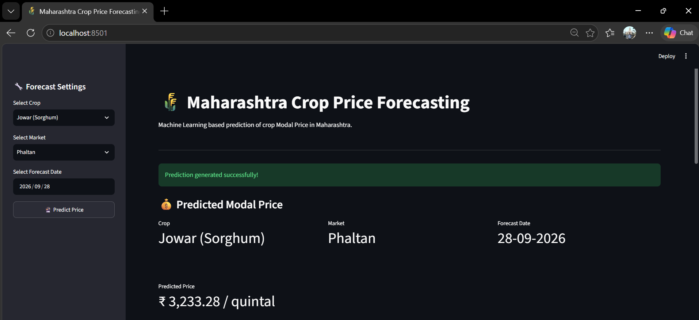
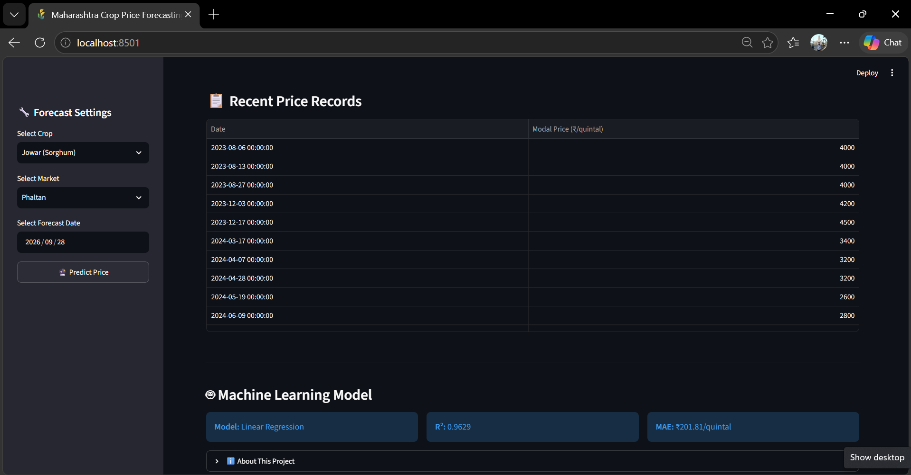
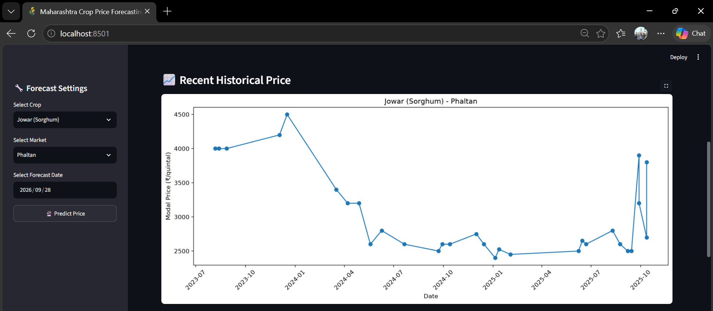

# 🌾 Maharashtra Crop Price Forecasting Using Machine Learning

A Machine Learning-based web application that predicts the **Modal Price of agricultural commodities in Maharashtra** using historical market data.

The application helps users explore recent crop prices and forecast future prices by selecting a crop, market, and forecast date.

## 📌 Project Overview

Agricultural prices fluctuate due to several factors, making it difficult for farmers and traders to estimate future market prices.

This project uses historical agricultural market data and Machine Learning algorithms to predict crop Modal Prices (₹ per quintal).

The application is developed using Python and Streamlit.

## 🎯 Objectives

- Analyze historical agricultural market prices.
- Predict future crop Modal Prices.
- Compare different Machine Learning algorithms.
- Display recent historical price trends.
- Provide an easy-to-use web interface for price forecasting.

## 🚀 Features

- Select an agricultural commodity.
- Select an available Maharashtra market.
- Choose a future forecast date.
- Predict the expected Modal Price.
- View recent historical price trends.
- Display model performance information.
- View recent price records.

## 🛠️ Technologies Used

| Technology | Purpose |
|---|---|
| Python | Programming |
| Pandas | Data processing |
| Scikit-learn | Machine Learning |
| Streamlit | Web application |
| Matplotlib | Data visualization |
| Joblib | Model loading |
| NumPy | Numerical operations |

## 📊 Dataset Information

The project uses historical agricultural market price data.

- State: Maharashtra
- Selected commodities: 10 crops
- Cleaned records: 424,009
- Markets: 522
- Districts: 33
- Data period: January 2023 – December 2025

The prepared dataset is stored in `Dataset/Maharashtra/final_model_data.csv`.

## 🤖 Machine Learning Models

The following algorithms were evaluated:

1. Linear Regression
2. Gradient Boosting
3. Random Forest

### Model Performance

| Model | MAE | RMSE | R² Score |
|---|---:|---:|---:|
| Linear Regression | 201.81 | 377.06 | 0.9629 |
| Gradient Boosting | 212.98 | 387.02 | 0.9609 |
| Random Forest | 205.29 | 387.43 | 0.9608 |

**Best Model:** Linear Regression (based on the lowest RMSE).

*Note: The Random Forest model was evaluated, but its large model file is not included in this repository.*

## ⚙️ Project Structure

```text
maharashtra-crop-price-forecasting/
│
├── Dataset/
│   ├── Maharashtra/
│   │   └── final_model_data.csv
│   └── check_data.py
│
├── Models/
│   ├── gradient_boosting.pkl
│   ├── linear_regression.pkl
│   └── model_comparison.csv
│
├── app.py
├── train.py
├── predict.py
├── requirements.txt
├── run.bat
└── .gitignore
```

## 💻 Installation and Setup

### 1. Clone the Repository

```bash
git clone https://github.com/sanketcybernet/maharashtra-crop-price-forecasting.git
```

### 2. Open the Project Folder

```bash
cd maharashtra-crop-price-forecasting
```

### 3. Create a Virtual Environment (Recommended)

```bash
python -m venv venv
```

Activate it on Windows:

```bash
venv\Scripts\activate
```

### 4. Install Required Libraries

```bash
pip install -r requirements.txt
```

### 5. Run the Application

```bash
streamlit run app.py
```

The application will open in your browser.

## 🔍 Prediction Methodology

The application uses the following input features:

- Year, Month and Day
- Day of Week and Day of Year
- Previous price (Lag 1, 7, 14 and 30)
- Rolling Mean (7 and 30 days)
- Commodity
- Market

**Target Variable:** `Modal_Price` (₹ per quintal).

## 📸 Application Screenshots

### 1. Crop Price Prediction


### 2. Historical Price Trends


### 3. Recent Price Records and Model Performance


## 📈 Future Improvements

- Integrate a live agricultural market data API.
- Expand coverage to all Indian states.
- Improve forecasting accuracy.
- Add more Machine Learning models.
- Deploy the application online.

## 👨‍💻 Author

**Sanket Sanjay Yadav**

B.E. Computer Science Engineering (AI & ML)

Saraswati College of Engineering, Kharghar, Navi Mumbai

GitHub: [@sanketcybernet](https://github.com/sanketcybernet)

---

⭐ If you find this project useful, consider giving it a star on GitHub.
